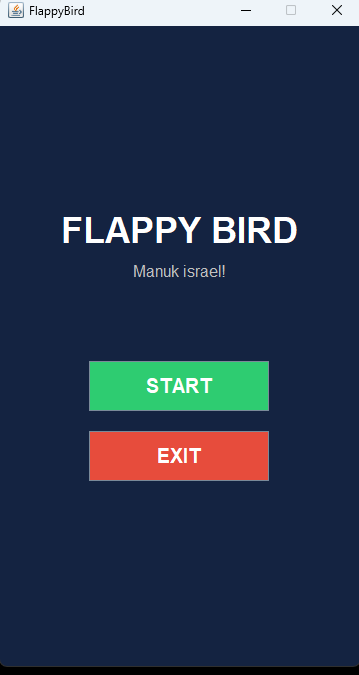
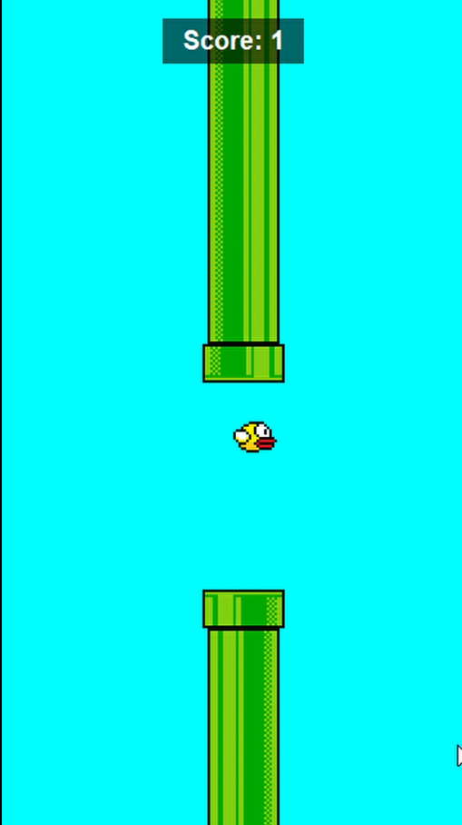
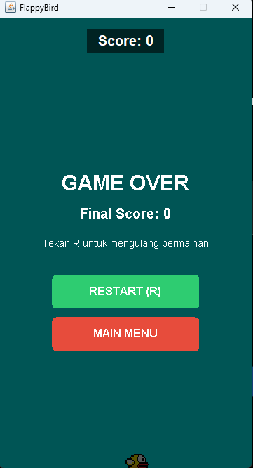

# TP6DPBO2526C2
manuk israel

## Janji

Saya Nabil Azka Saputra dengan NIM 2507096 mengerjakan Tugas Praktikum 6 pada Mata Kuliah Desain dan Pemrograman Berorientasi Objek untuk keberkahan-Nya maka saya tidak melakukan kecurangan seperti yang telah dispesifikasikan. Aamiin.

## Penjelasan Desaine

Program ini merupakan permainan **Flappy Bird** sederhana yang dibuat
menggunakan Java Swing. Pemain mengendalikan burung untuk melewati
rintangan berupa pipa yang bergerak dari kanan ke kiri. Setiap pipa yang
berhasil dilewati akan menambah skor. Permainan berakhir ketika burung
menabrak pipa atau menyentuh batas bawah area permainan. Setelah Game
Over, pemain dapat mengulang permainan atau kembali ke menu utama.

### Desain Program

1. **Aplikasi (`App.java`)**  
   Menjadi titik awal program dan mengatur jendela utama menggunakan
   `JFrame` serta perpindahan tampilan menggunakan `CardLayout`. Menu
   utama menyediakan tombol **Start** untuk memulai permainan dan
   **Exit** untuk keluar. Aplikasi juga mengatur perpindahan kembali
   dari permainan ke menu utama.
2. **Model Pemain (`Player.java`)**  
   Menyimpan posisi, ukuran, gambar, dan kecepatan vertikal burung yang
   dikendalikan pemain.
3. **Model Rintangan (`Pipe.java`)**  
   Menyimpan posisi, ukuran, gambar, dan status apakah pipa sudah
   dilewati pemain.
4. **Logika Permainan (`Logic.java`)**  
   Mengatur gravitasi, pergerakan pemain dan pipa, pembuatan rintangan,
   deteksi tabrakan, perhitungan skor, kondisi Game Over, restart,
   serta input keyboard. Pembaruan permainan dijalankan secara berkala
   menggunakan `Timer`.
5. **Tampilan Permainan (`View.java`)**  
   Mengatur area permainan menggunakan Java Swing. Kelas ini menggambar
   pemain dan pipa melalui `paintComponent()`, menampilkan skor, serta
   menampilkan layar **GAME OVER** yang berisi skor akhir, informasi
   tombol restart, dan tombol **Restart** serta **Main Menu**.
6. **Pengelola Audio (`SoundManager.java`)**  
   Mengelola musik latar dan efek suara ketika burung mengepakkan
   sayap, memperoleh skor, dan permainan berakhir. Audio dimuat dari
   berkas WAV di folder aset.

### Alur Program

1. Program menampilkan menu utama dengan
   tombol **Start** dan **Exit**.
2. Ketika **Start** ditekan, objek `Logic` dan
   `View` dibuat. Tampilan permainan ditampilkan dan musik latar
   diputar. Jika pemain sebelumnya kembali ke menu utama setelah Game
   Over, permainan diatur ulang sebelum dimulai kembali.
3. Tombol **Space** membuat burung bergerak
   ke atas. Gravitasi membuat burung bergerak kembali ke bawah secara
   bertahap.
4. Program membuat pasangan pipa atas dan
   bawah secara berkala. Posisi celah antarpipa dibuat bervariasi.
5. Program memeriksa tabrakan burung dengan
   pipa dan batas bawah area permainan. Jika terjadi tabrakan,
   permainan dihentikan dan layar **GAME OVER** ditampilkan.
6. Skor bertambah ketika burung berhasil melewati
   pasangan pipa. Skor diperbarui pada tampilan dan disertai efek
   suara.
7. Layar **GAME OVER** menampilkan skor akhir dan petunjuk untuk menekan
   tombol **R**. Pemain dapat menekan **R** atau mengeklik
   tombol **Restart** untuk mengulang permainan. Pemain juga dapat mengeklik
   tombol **Main Menu** untuk kembali ke menu utama.
8. Tombol **Exit** pada menu utama digunakan untuk menutup aplikasi.

### Kontrol Permainan

| Tombol      | Fungsi                                                  |
| ----------- | ------------------------------------------------------- |
| `Space`     | Membuat burung mengepak dan bergerak ke atas            |
| `R`         | Mengulang permainan setelah Game Over                   |
| `Restart`   | Mengulang permainan melalui tombol pada layar Game Over |
| `Main Menu` | Kembali ke menu utama setelah Game Over                 |
| `Start`     | Memulai permainan dari menu utama                       |
| `Exit`      | Keluar dari aplikasi                                    |

## Dokumentasi

[https://github.com/laflaga404/TP6DPBO2526C2/issues/1#issue-6166767792](https://github.com/user-attachments/assets/a1d452a5-9451-4f56-856e-2c0c48b326fd)

